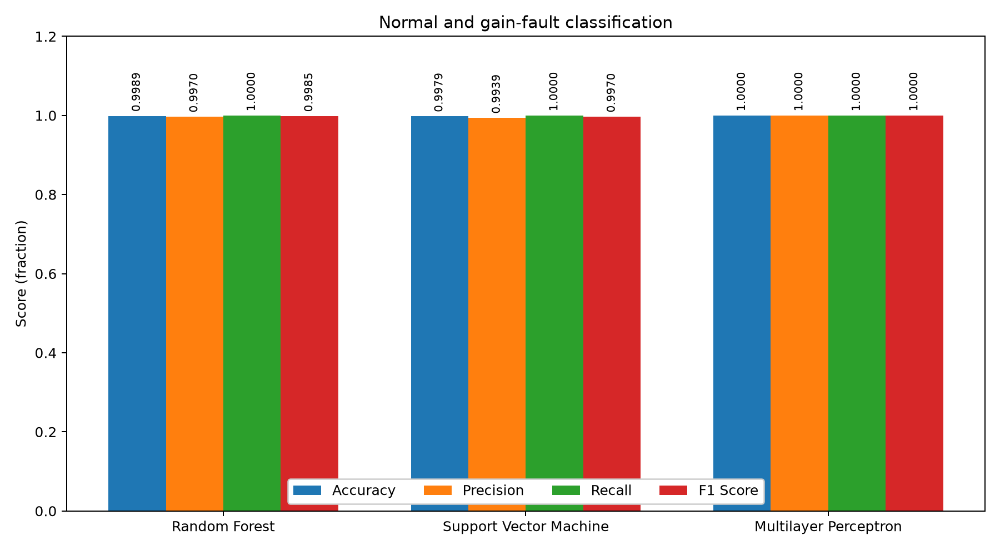
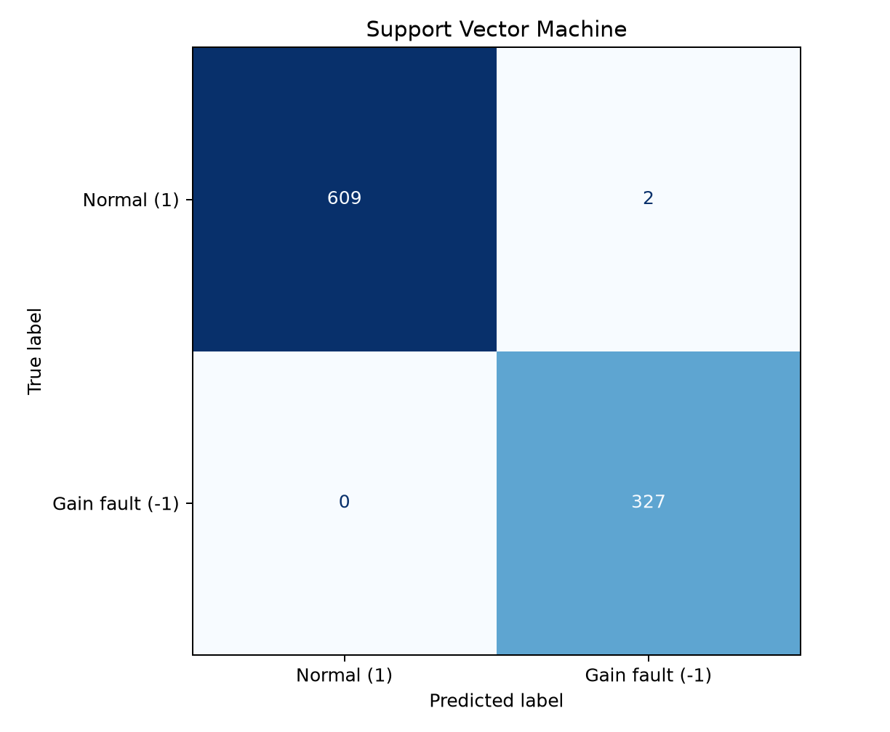

# Sensor Fault Detection Experiment

## Objective

Compare Random Forest, SVM, and MLP to see how well they distinguish normal sensor readings from gain faults.

## Dataset

The data come from the [wireless sensor dataset](https://github.com/tmoulahi/Dataset-for-WSN-fault-detection/blob/a36f90b55b30ba3552747430fb508735025ca80b/README.md) published by Zidi, Moulahi, and Alaya. The selected files are `Gain/beta=2/gain302.xlsx` and `Gain/beta=2/ygain302.xlsx`. They contain 4,688 observations: 3,280 normal and 1,408 gain faults. This is the nominal 30% fault dataset.

Each observation contains two temperature and two humidity readings at three consecutive time steps, giving twelve features: T01, H01, T02, H02, T11, H11, T12, H12, T21, H21, T22, H22. The labels are 1 for normal and -1 for gain fault. The rows match between the two files, and there are no missing or infinite values.

## Method

The rows were kept in their original order. Neighbouring rows share measurements, so randomly splitting them would allow some readings to appear in both training and testing. The first 3,748 rows were used for training, rows 3748 and 3749 were skipped, and the last 938 rows were used for testing. Row numbers start at zero. All three models used the same split.

Random Forest used 100 trees. SVM used an RBF kernel with C=1 and gamma=scale. MLP used two hidden layers with 32 and 16 neurons and a maximum of 1,000 iterations. The random state was 42 for Random Forest and MLP. SVM and MLP inputs were standardized using only the training data. Random Forest used unscaled inputs. Each pipeline includes a median imputer, although these files have no missing values. No parameters were tuned.

Gain fault was treated as the positive class. A false positive is a normal reading flagged as faulty; a false negative is a fault that the model missed.

## Results

Scores are fractions; gain fault is the positive class.

| Model | Accuracy | Precision | Recall | F1 Score | False Positive Rate | False Negative Rate |
| --- | --- | --- | --- | --- | --- | --- |
| Random Forest | 0.998934 | 0.996951 | 1.000000 | 0.998473 | 0.001637 | 0.000000 |
| Support Vector Machine | 0.997868 | 0.993921 | 1.000000 | 0.996951 | 0.003273 | 0.000000 |
| Multilayer Perceptron | 1.000000 | 1.000000 | 1.000000 | 1.000000 | 0.000000 | 0.000000 |

- Random Forest: 1 false alarm, 0 missed faults.
- Support Vector Machine: 2 false alarms, 0 missed faults.
- Multilayer Perceptron: 0 false alarms, 0 missed faults.

The confusion matrices show actual classes in rows and predicted classes in columns.

## Observations

Multilayer Perceptron had the highest accuracy on this test set. The high scores suggest that the selected gain faults are easy for these models to separate from normal readings. They do not show how the models would perform on other faults or on a different sensor network.

## Limitations

Only one gain-fault dataset, one fault percentage, and one training/test split were tested. The experiment does not cover unseen devices or other fault types. The gap removes shared measurements at the split boundary, but nearby observations may still be related. Classification accuracy alone does not measure network reliability.

## Next steps

Test offset, stuck-at, and out-of-bounds faults, then compare different fault percentages. Further work should examine false alarms and missed faults across separate time blocks and sensor devices where suitable data are available.
