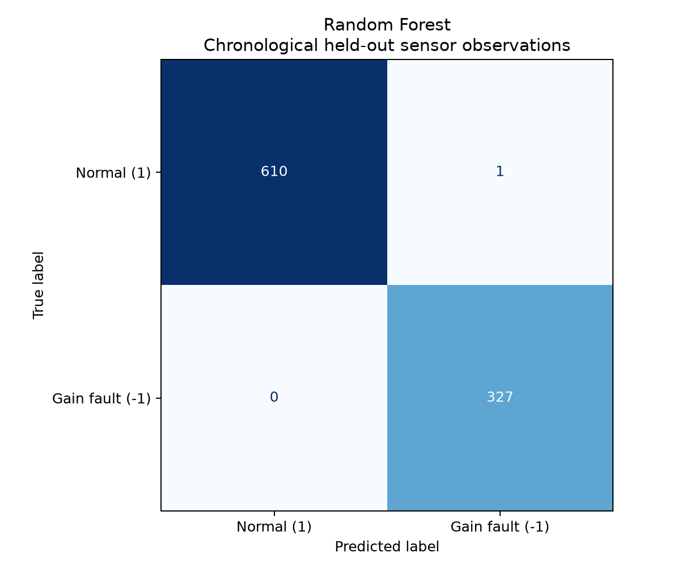
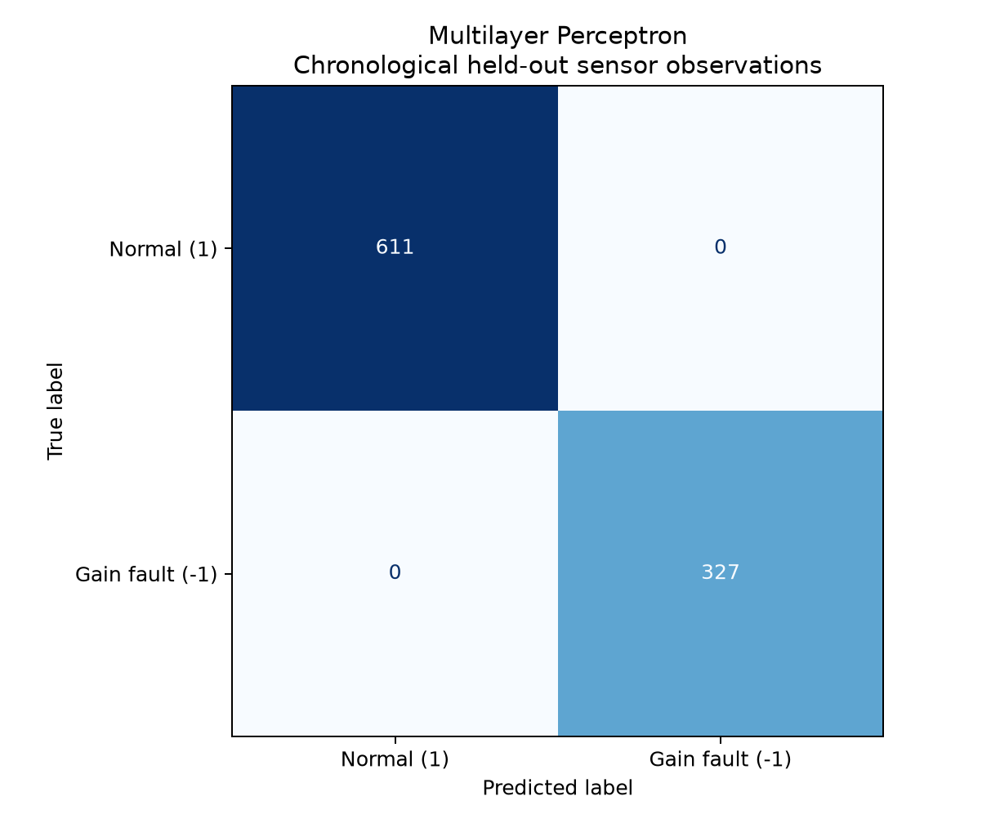

# Initial Sensor Fault Detection Experiment

Fall 2026 semester-end progress report — first experimental milestone

## 1. Objective

This initial experiment asks how well Random Forest, Support Vector Machine, and Multilayer Perceptron distinguish normal sensor readings from gain-fault readings. It establishes a simple baseline for the Fall 2026 semester-end progress report.

## 2. Dataset

The experiment uses temperature and humidity data from the public [Dataset for Wireless Sensor Network Fault Detection](https://github.com/tmoulahi/Dataset-for-WSN-fault-detection/blob/a36f90b55b30ba3552747430fb508735025ca80b/README.md) by Zidi, Moulahi, and Alaya. The selected files are `Gain/beta=2/gain302.xlsx` and `Gain/beta=2/ygain302.xlsx`, the nominal 30% gain-fault variant. The actual files contain 4,688 observations and 12 input features: T01, H01, T02, H02, T11, H11, T12, H12, T21, H21, T22, H22. These represent two temperature and two humidity readings at each of three successive time steps. The authors document `1 = normal` and `-1 = faulty`; in this selection, faults are gain faults. The verified distribution is 3,280 normal and 1,408 faulty observations (30.0341% faulty). The feature workbook has two header rows; the label workbook has none. Feature rows and labels align, with 0 missing and 0 infinite input values.

## 3. Methodology

The first nominal 80% of observations are used for training and the last 20% for testing, in their supplied sequence. Adjacent observations share eight measurements across three-step windows, so a random split is avoided. Two rows at the end of the nominal training block are removed: zero-based rows 3748 and 3749. Training uses rows 0–3747 (3,748 observations: 2,669 normal, 1,079 faulty). Testing uses rows 3750–4687 (938 observations: 611 normal, 327 faulty). All three models use these same partitions.

Random Forest uses 100 trees and random state 42. The Support Vector Machine uses an RBF kernel with default C=1 and gamma=scale. The Multilayer Perceptron uses hidden layers of 32 and 16 neurons, random state 42, and at most 1,000 iterations. SVM and MLP use StandardScaler pipelines; Random Forest uses unscaled inputs. The existing median imputer and all scalers fit only on training data; no imputation is needed for the observed files. No hyperparameter tuning, synthetic observations, or additional fault types are used.

Gain fault (-1) is the positive class. Accuracy is (TP+TN)/N; precision is TP/(TP+FP); recall is TP/(TP+FN); F1 is the harmonic mean of precision and recall; false positive rate is FP/(FP+TN); false negative rate is FN/(FN+TP).

## 4. Results

All scores are fractions, not percentages.

| Model | Accuracy | Precision | Recall | F1 Score | False Positive Rate | False Negative Rate |
| --- | --- | --- | --- | --- | --- | --- |
| Random Forest | 0.998934 | 0.996951 | 1.000000 | 0.998473 | 0.001637 | 0.000000 |
| Support Vector Machine | 0.997868 | 0.993921 | 1.000000 | 0.996951 | 0.003273 | 0.000000 |
| Multilayer Perceptron | 1.000000 | 1.000000 | 1.000000 | 1.000000 | 0.000000 | 0.000000 |

- Random Forest: accuracy 0.998934, 1 false alarm and 0 missed faults (TN=610, FP=1, FN=0, TP=327).
- Support Vector Machine: accuracy 0.997868, 2 false alarms and 0 missed faults (TN=609, FP=2, FN=0, TP=327).
- Multilayer Perceptron: accuracy 1.000000, 0 false alarms and 0 missed faults (TN=611, FP=0, FN=0, TP=327).

Confusion matrix rows are actual classes and columns are predicted classes, ordered Normal (1), Gain fault (-1).

## 5. Initial Observations

The highest accuracy in this run was achieved by Multilayer Perceptron. These scores describe only the selected gain-fault data and this later test segment. Very high or perfect accuracy is retained as measured. One injected fault type can produce patterns that are easy to distinguish; these results do not establish general fault-detection performance or real-world network reliability.

## 6. Limitations

This preliminary experiment uses only gain faults, one selected fault percentage, and one training/testing partition. It does not evaluate unseen sensor devices or other fault categories. The two-row gap removes direct overlap at the boundary, but nearby time windows may remain correlated. The files supply no device identifiers or timestamps for independent device evaluation. Detection scores do not measure network uptime or sensor lifetime.

## 7. Next Semester Plan

- January 2027: Test offset, stuck-at, and out-of-bounds faults.
- February 2027: Compare performance across different fault percentages.
- March 2027: Analyze false alarms, missed faults, and model reliability.
- April 2027: Complete experiments, prepare graphs, analyze findings, and write the final research report.

This is the first semester's progress report. The final research report is planned for Spring 2027.
