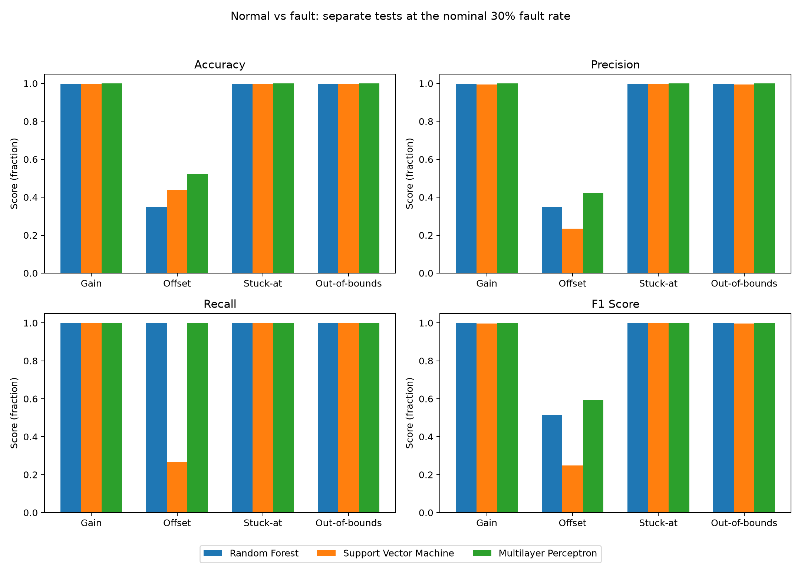
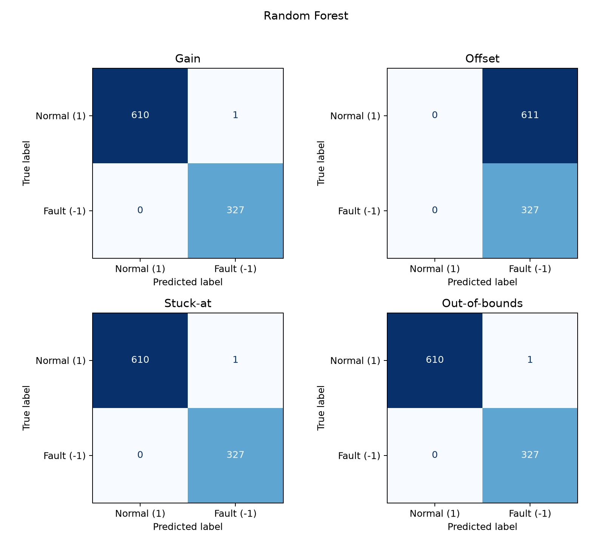
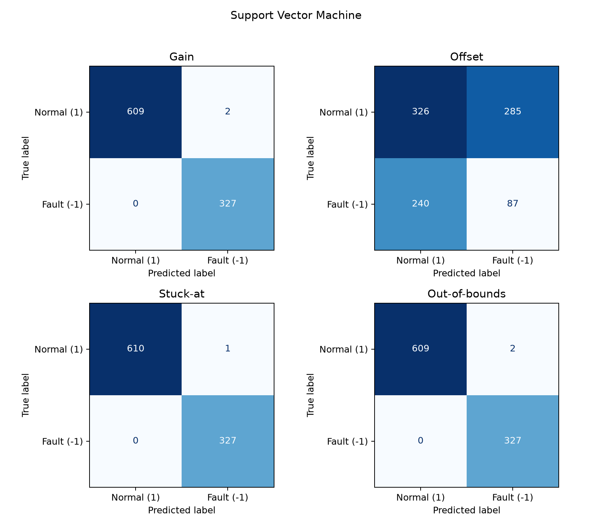
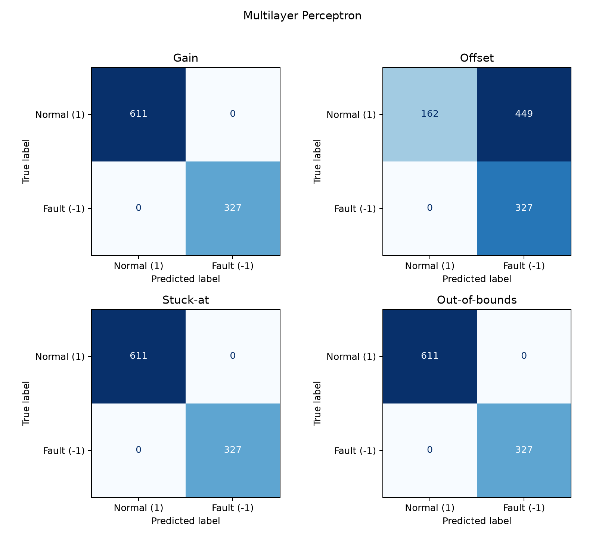

# Sensor Fault Detection Experiment

## Objective

Compare Random Forest, Support Vector Machine (SVM), and Multilayer Perceptron (MLP) on gain, offset, stuck-at, and out-of-bounds faults. Each test asks whether a sensor observation is normal or faulty. The aim is to see how the models' errors change across fault types.

## Dataset

The data come from the [Dataset for Wireless Sensor Network Fault Detection](https://github.com/tmoulahi/Dataset-for-WSN-fault-detection/blob/a36f90b55b30ba3552747430fb508735025ca80b/README.md) by Zidi, Moulahi, and Alaya. Four nominal 30% fault datasets were selected: gain, offset, stuck-at, and out-of-bounds. Gain and offset use the beta=2 directory. The other two archives have no beta directories.

- Gain: `Gain/beta=2/gain302.xlsx` and `Gain/beta=2/ygain302.xlsx`.
- Offset: `Offset/beta=2/offset302.xlsx` and `Offset/beta=2/y302.xlsx`.
- Stuck-at: `Stuck-at/stuck302.xlsx` and `Stuck-at/ystuck302.xlsx`.
- Out-of-bounds: `Out of bound/out302.xlsx` and `Out of bound/yout302.xlsx`.

| Fault | Observations | Normal | Faulty |
| --- | --- | --- | --- |
| Gain | 4,688 | 3,280 | 1,408 |
| Offset | 4,688 | 3,280 | 1,408 |
| Stuck-at | 4,688 | 3,280 | 1,408 |
| Out-of-bounds | 4,688 | 3,280 | 1,408 |

Each observation contains two temperature and two humidity readings at three consecutive time steps, giving twelve features: T01, H01, T02, H02, T11, H11, T12, H12, T21, H21, T22, H22. The source labels are 1 for normal and -1 for faulty. All four files have matching label sequences, and no missing or infinite values. These are altered versions of the same underlying sensor series, not four independent sensor networks.

## Method

Each fault type was tested separately as normal versus faulty. The files were not pooled into one dataset. Every model was trained again for each fault type using the same settings.

Rows stayed in their original order. Adjacent observations share measurements, so a random split would allow some readings to appear in training and testing. Each test used 3,748 training rows (zero-based rows 0 to 3747), skipped rows 3748 and 3749, and tested on the last 938 rows (3750 to 4687). The test set contained 611 normal and 327 faulty observations for each fault type. All twelve model/fault comparisons used these same row positions.

Random Forest used 100 trees. SVM used a radial basis function kernel with C=1 and gamma=scale. MLP used two hidden layers of 32 and 16 neurons and a maximum of 1,000 iterations. The random state was 42 for Random Forest and MLP. SVM and MLP inputs were standardized using only the training data; Random Forest used unscaled inputs. The existing median imputer stayed in the pipelines, although none of the selected files needed imputation. No parameters were tuned.

Fault (-1) was the positive class. A false positive is a normal observation flagged as faulty; a false negative is a missed fault. Precision, recall, and F1 refer to faults. False positive rate is FP/(FP+TN), and false negative rate is FN/(FN+TP).

## Results

Scores are fractions; fault is the positive class.

| Fault | Model | Accuracy | Precision | Recall | F1 Score | False Positive Rate | False Negative Rate |
| --- | --- | --- | --- | --- | --- | --- | --- |
| Gain | Random Forest | 0.998934 | 0.996951 | 1.000000 | 0.998473 | 0.001637 | 0.000000 |
| Gain | Support Vector Machine | 0.997868 | 0.993921 | 1.000000 | 0.996951 | 0.003273 | 0.000000 |
| Gain | Multilayer Perceptron | 1.000000 | 1.000000 | 1.000000 | 1.000000 | 0.000000 | 0.000000 |
| Offset | Random Forest | 0.348614 | 0.348614 | 1.000000 | 0.516996 | 1.000000 | 0.000000 |
| Offset | Support Vector Machine | 0.440299 | 0.233871 | 0.266055 | 0.248927 | 0.466448 | 0.733945 |
| Offset | Multilayer Perceptron | 0.521322 | 0.421392 | 1.000000 | 0.592928 | 0.734861 | 0.000000 |
| Stuck-at | Random Forest | 0.998934 | 0.996951 | 1.000000 | 0.998473 | 0.001637 | 0.000000 |
| Stuck-at | Support Vector Machine | 0.998934 | 0.996951 | 1.000000 | 0.998473 | 0.001637 | 0.000000 |
| Stuck-at | Multilayer Perceptron | 1.000000 | 1.000000 | 1.000000 | 1.000000 | 0.000000 | 0.000000 |
| Out-of-bounds | Random Forest | 0.998934 | 0.996951 | 1.000000 | 0.998473 | 0.001637 | 0.000000 |
| Out-of-bounds | Support Vector Machine | 0.997868 | 0.993921 | 1.000000 | 0.996951 | 0.003273 | 0.000000 |
| Out-of-bounds | Multilayer Perceptron | 1.000000 | 1.000000 | 1.000000 | 1.000000 | 0.000000 | 0.000000 |

## Observations

- **Gain:** accuracy ranged from 99.79% to 100.00%. Highest fault F1: Multilayer Perceptron. Random Forest: 1 false alarm, 0 missed faults; Support Vector Machine: 2 false alarms, 0 missed faults; Multilayer Perceptron: 0 false alarms, 0 missed faults.
- **Offset:** accuracy ranged from 34.86% to 52.13%. Highest fault F1: Multilayer Perceptron. Random Forest: 611 false alarms, 0 missed faults; Support Vector Machine: 285 false alarms, 240 missed faults; Multilayer Perceptron: 449 false alarms, 0 missed faults.
- **Stuck-at:** accuracy ranged from 99.89% to 100.00%. Highest fault F1: Multilayer Perceptron. Random Forest: 1 false alarm, 0 missed faults; Support Vector Machine: 1 false alarm, 0 missed faults; Multilayer Perceptron: 0 false alarms, 0 missed faults.
- **Out-of-bounds:** accuracy ranged from 99.79% to 100.00%. Highest fault F1: Multilayer Perceptron. Random Forest: 1 false alarm, 0 missed faults; Support Vector Machine: 2 false alarms, 0 missed faults; Multilayer Perceptron: 0 false alarms, 0 missed faults.

Random Forest accuracy ranged from 34.86% to 99.89% across the four fault types. Support Vector Machine accuracy ranged from 44.03% to 99.89% across the four fault types. Multilayer Perceptron accuracy ranged from 52.13% to 100.00% across the four fault types.

On offset faults, Random Forest flagged all 938 test observations as faulty, including all 611 normal observations. SVM missed 240 faults. MLP had the highest offset accuracy, but still raised 449 false alarms. All three models performed poorly on this offset test segment. A check of the first temperature feature, T01, found that normal test values (26.29 to 26.79) were below its normal training range (26.96 to 48.24). This change in the later segment may contribute to the errors; it does not establish their sole cause.

The differences apply to the selected files and settings. High scores on an easier fault type do not show that a model will detect other faults equally well.

## Confusion matrices

Actual classes are in rows and predicted classes are in columns.

## Limitations

These results use one fault percentage, one selected version of each fault, and one chronological split. The four datasets share the same underlying sensor readings, so they do not provide independent evidence from four networks. The two-row gap removes direct window overlap at the split boundary, but nearby observations may still be related. The source has no device identifiers for an unseen-device test. The results describe detection on these files, not network uptime or performance in a deployment. The same fault percentage does not mean equal fault severity across categories. A single split does not establish a reliable overall model ranking or statistical significance.

## Next steps

Compare other fault percentages and beta directories using a selection fixed before training. Repeat the evaluation across separate time blocks, then test on other sensor devices where suitable data are available. Keep track of missed faults as well as overall accuracy.
